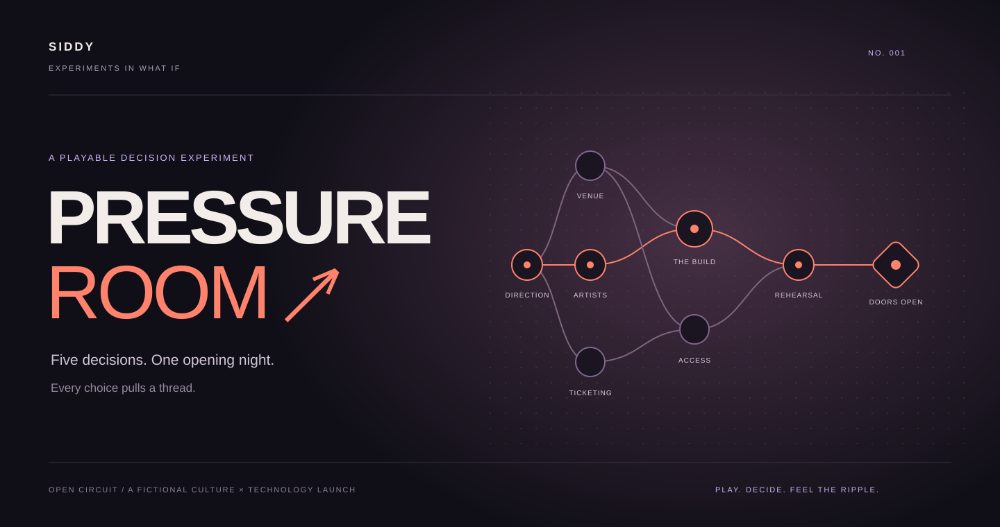

# Pressure Room

**Experiment 001 · Experiments in What If · by Siddy**

Five calls. A room full of people. Something has to give.

[**Enter Pressure Room →**](https://pressure-room-siddy.vocal-pike-2232.chatgpt.site) · [Read the case study](docs/CASE_STUDY.md)

## What will you protect?

You are running **Open Circuit**, a fictional culture-and-technology launch for 1,200 guests. The room is booked. The promise is out there. Five incidents challenge the plan, and every response changes the schedule, reserve, crew energy, or audience trust.

Choose a contract, enter the room, and live with the call you make.

| Contract | Your priority |
|---|---|
| **Open the doors** | Deliver a viable opening without exhausting the people or the budget. |
| **Become the story** | Protect the audience's trust and give them a night worth talking about. |
| **Get everyone home** | Protect the crew while bringing the launch across the line. |

## Play your way

- **Pressure:** two forecast scans, one rewind, and imperfect information.
- **Sandbox:** inspect every projected consequence and explore at your own pace.
- **Aftermath:** ghostly consequence scenes and transmissions that acknowledge earlier calls.
- **Another route:** finish, branch from an earlier decision, and compare your endings.
- **Your pace:** optional sound, motion and depth controls, immediately skippable scenes, and a local archive of six runs.

No account is required. The current experience contains one scenario, five incidents, and three contracts.

## About the experiment

Pressure Room explores how a small decision can move through a larger system. Its rules are authored and deterministic; its atmosphere turns those tradeoffs into a playable story. The fictional results illustrate choices, not a person's real-world management ability.

**Experiments in What If** is an ongoing collection of interactive ideas for curious creatives, professionals, and builders.

## Project notes

- [Case study: from planning experiment to game](docs/CASE_STUDY.md)
- [Architecture and verification overview](docs/PROJECT_OVERVIEW.md)

The current live release is **v0.2**. Model and document-environment checks pass; a complete desktop/mobile browser playtest remains in progress. The case study explains the verification boundary.

## This repository

This is the **public showcase**: presentation assets and project documentation. Application source and development history are not included here. Any future code excerpts will be selected and labeled explicitly.

Creative direction and review: **Siddy**. Developed with ChatGPT and AI coding assistance.
